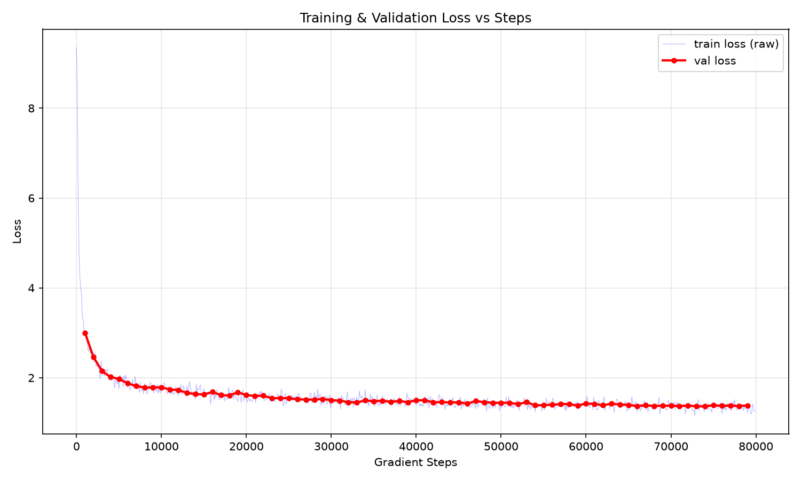
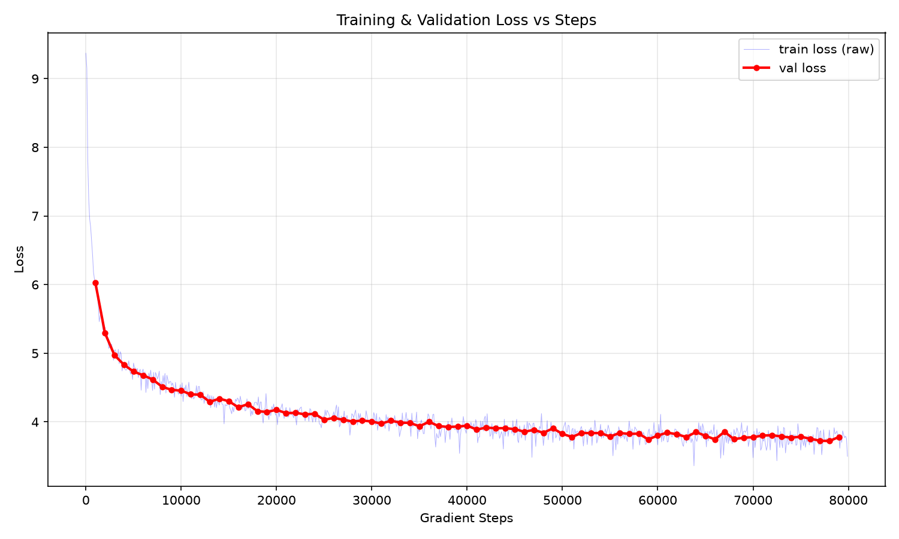
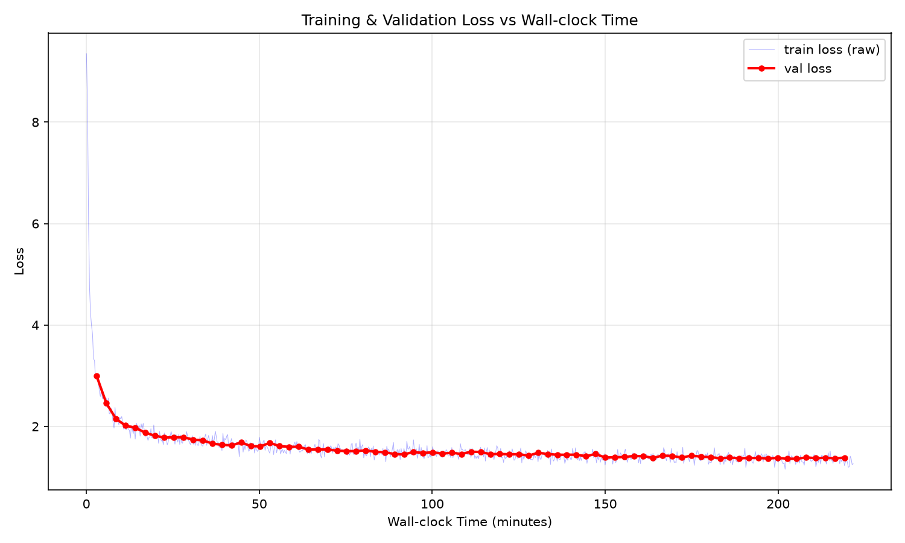
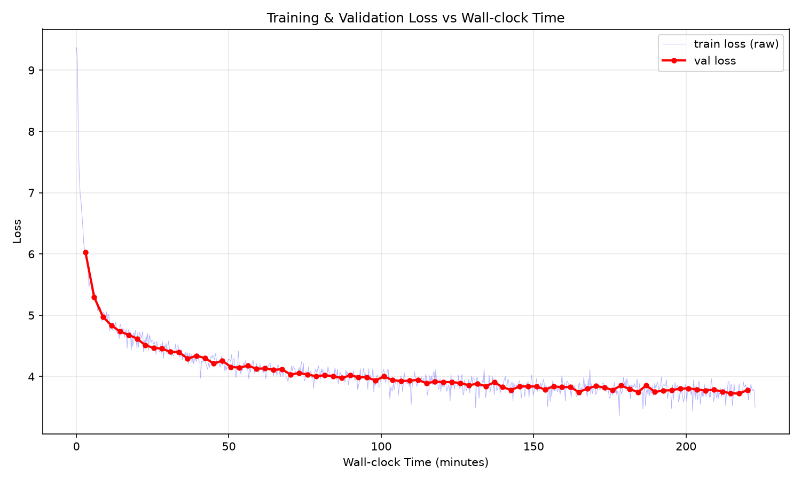
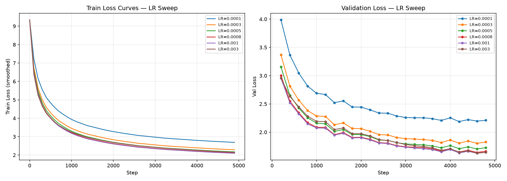
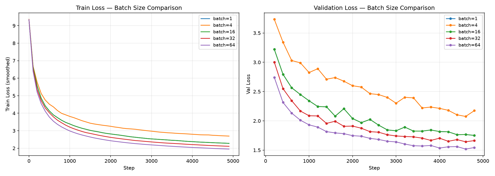
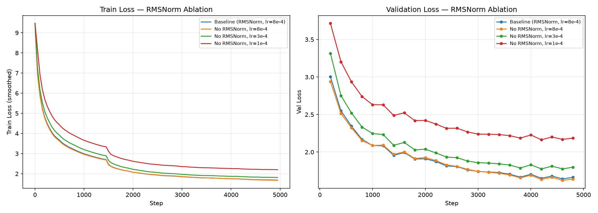
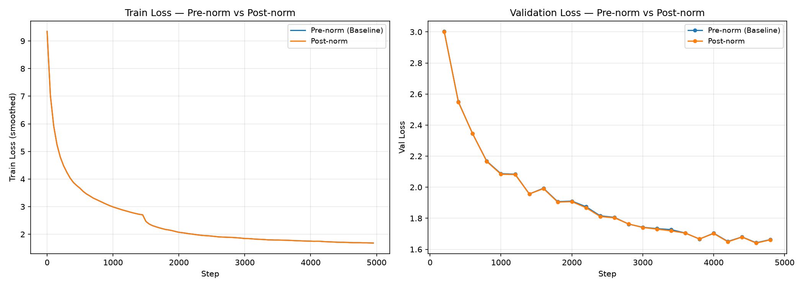
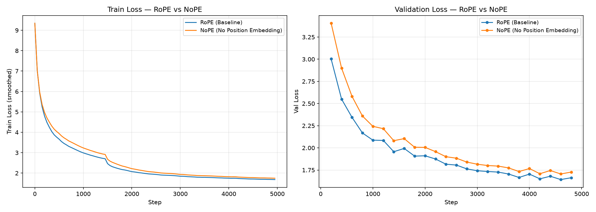
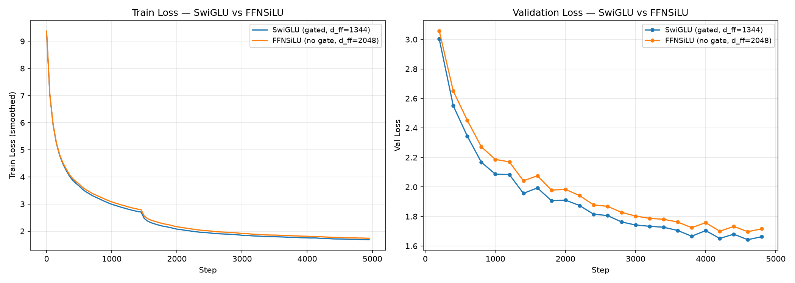

# Transformer Language Model from Scratch

An end-to-end implementation of a decoder-only Transformer language model for the Stanford CS336 *Language Modeling from Scratch* assignment. The project builds the training stack from first principles: byte-pair encoding, Transformer components, optimization, checkpointing, evaluation, and text decoding. It also documents controlled experiments on TinyStories and OpenWebText.

All assignment components are implemented, including an OpenWebText leaderboard-style training run. That run used a 32,000-token vocabulary and completed 50,000 optimization steps in approximately 220 minutes. Its architecture and token budget differ from the assignment reference configuration, so it is reported as an experimental reproduction rather than an official leaderboard submission.

## Highlights

- Implemented byte-level BPE training, encoding, decoding, special-token handling, and Hugging Face tokenizer export.
- Built a decoder-only Transformer with causal multi-head attention, RoPE, RMSNorm, pre-normalization, and SwiGLU feed-forward layers.
- Implemented scaled dot-product attention, cross-entropy, AdamW, cosine learning-rate scheduling with warm-up, gradient clipping, sampling, checkpointing, and memory-mapped data loading.
- Trained models on TinyStories and OpenWebText, saving JSONL metrics, checkpoints, tokenizer artifacts, and plots.
- Ran learning-rate and batch-size sweeps plus RMSNorm, pre-norm, RoPE, and SwiGLU ablations.

## Repository guide: foundation components

The project begins with text processing, BPE tokenization, and independently tested utility components. The original `train_bpe.py` reads the full corpus; the actual memory-constrained training uses the chunked `train_bpe2.py`. Its tokenizer artifact flow is `pkl_to_hf_tokenizer.py` → `export_tokenizer_json.py` → `encode_train_hf.py` → `merge_shards_memmap.py`.

```text
cs336_basics/
|-- __init__.py                  # Package version metadata.
|-- tokenizer.py                 # From-scratch byte-level BPE tokenizer.
|-- train_bpe.py                 # Original full-corpus BPE trainer.
|-- train_bpe2.py                # Chunked BPE trainer used for memory-constrained runs.
|-- train_bpe_tinystories.py     # TinyStories BPE-training entry point.
|-- train_bpe_expts_owt.py       # OWT BPE-training entry point; calls `train_bpe2.py`.
|-- pkl_to_hf_tokenizer.py       # Converts BPE pickles to Hugging Face `vocab.json` and `merges.txt`.
|-- export_tokenizer_json.py     # Builds `tokenizer.json` from the Hugging Face vocabulary files.
|-- encode_train_hf.py           # Shard-based text encoding using `tokenizer.json`.
|-- merge_shards_memmap.py       # Combines token shards into the final `uint16` memory-mapped array.
|-- pretokenization_example.py   # Parallel-safe pre-tokenization chunking example.
|-- tokenizer_experiments.py     # Tokenizer throughput and behavior experiments.
|-- softmax.py                   # Numerically stable softmax primitive.
|-- linear.py                    # From-scratch linear layer.
|-- embedding.py                 # Learnable token embedding layer.
|-- rmsnorm.py                   # RMSNorm layer.
|-- rope.py                      # Rotary positional embeddings.
|-- scaled_dot_product_attention.py # Attention kernel using `softmax.py`.
|-- multihead_self_attention.py  # Non-RoPE attention reference variant.
|-- cross_entropy.py             # Cross-entropy and perplexity helpers.
|-- adamw.py                     # From-scratch AdamW optimizer.
|-- learning_rate_schedule.py    # Linear warm-up plus cosine decay.
|-- gradient_clipping.py         # Global-norm clipping.
`-- sgd_example.py               # Minimal SGD learning example.

tests/
|-- __init__.py                  # Marks the test directory as a Python package.
|-- adapters.py                  # Assignment compatibility wrappers for components under test.
|-- common.py                    # Shared test utilities.
|-- conftest.py                  # Pytest fixtures and configuration.
|-- test_tokenizer.py            # Tokenizer tests.
|-- test_train_bpe.py            # BPE-training tests.
|-- test_model.py                # Model/component tests.
|-- test_nn_utils.py             # Neural-network utility tests.
|-- test_data.py                 # Data-loading tests.
|-- test_optimizer.py            # Optimizer tests.
`-- test_serialization.py        # Checkpoint serialization tests.
```

## Test verification

The foundational tokenizer, neural-network, optimizer, data-loading, and checkpoint components were implemented and checked with the assignment adapters before building the language-model training pipeline. The following command was run from the `Assignment1/` directory:

```bash
uv run pytest
```

| Result | Count | Notes |
| --- | ---: | --- |
| Passed | 46 | All implemented assignment components passed their unit tests. |
| Failed | 1 | `tests/test_model.py::test_silu_matches_pytorch` calls `tests/adapters.py::run_silu`, which remains `NotImplementedError`; SiLU was not a required standalone function in the assignment handout. |
| XPASS | 1 | `tests/test_tokenizer.py::test_encode_memory_usage`; the tokenizer used less memory than the test's expected-failure condition. |

The recorded run used Python 3.13.16, pytest 9.0.2, and collected 48 tests. The failed adapter is test scaffolding rather than a language-model training-pipeline component.

## Repository guide: language model and experiments

After the foundation components, `transformer_lm.py` stacks `transformer_block.py`; each block combines causal RoPE attention, RMSNorm, and the feed-forward network. `train_loop.py` then coordinates configuration, memory-mapped data, model construction, optimization, evaluation, checkpointing, and JSONL logging.

```text
cs336_basics/
|-- positionwise_feedforward.py  # SwiGLU or SiLU feed-forward sublayer.
|-- multihead_self_attention_rope.py # Causal RoPE attention used by Transformer blocks.
|-- transformer_block.py         # Attention, feed-forward, residual, and normalization block.
|-- transformer_lm.py            # Decoder-only LM built from embeddings and Transformer blocks.
|-- config.py                    # Training CLI arguments and defaults.
|-- data_layer.py                # Opens memory-mapped token arrays.
|-- data_loading.py              # Random contiguous-window batch sampler.
|-- model_layer.py               # Creates the Transformer, optimizer, loss, and scheduler helpers.
|-- train_step.py                # One optimization step.
|-- eval_layer.py                # No-gradient validation and perplexity calculation.
|-- checkpointing.py             # Model/optimizer state serialization.
|-- checkpoint_layer.py          # Training-loop checkpoint wrapper.
|-- experiment_logger.py         # JSONL train/eval metrics writer.
|-- log_layer.py                 # Console metric formatting.
|-- train_loop.py                # Main training orchestration entry point.
|-- decoding.py                  # Temperature and top-p token generation.
|-- tinystories_example.py       # Loads a TinyStories checkpoint and generates with `decoding.py`.
|-- train_lr_sweep.py            # Repeats `train_loop.py` across learning rates.
|-- train_batch_sweep.py         # Repeats `train_loop.py` across batch sizes.
|-- train_ablation_rmsnorm.py    # RMSNorm ablation runs.
|-- train_ablation_prenorm.py    # Pre-norm/post-norm ablation runs.
|-- train_ablation_nope.py       # RoPE/NoPE ablation runs.
|-- train_ablation_swiglu.py     # SwiGLU/SiLU-FFN ablation runs.
|-- plot_experiment.py           # General JSONL training-curve plotter.
|-- plot_lr_sweep.py             # Learning-rate sweep plots.
|-- plot_batch_sweep.py          # Batch-size sweep plots.
|-- plot_ablation_rmsnorm.py     # RMSNorm ablation plots.
|-- plot_ablation_prenorm.py     # Pre-norm ablation plots.
|-- plot_ablation_nope.py        # RoPE/NoPE ablation plots.
`-- plot_ablation_swiglu.py      # SwiGLU ablation plots.
```

## Language-model design

### Tokenization and data pipeline

The project trains a byte-level BPE tokenizer from raw text. Text is pre-tokenized with a GPT-2-style regular expression, converted to bytes, and merged iteratively according to learned BPE ranks. The tokenizer supports special tokens, reversible decoding, and streaming encoding. Learned vocabularies and merge tables are exported both as Python pickles and as Hugging Face-compatible tokenizer files.

For training, token IDs are stored as compact `uint16` NumPy arrays and loaded through memory mapping. Each optimization step samples independent contiguous windows and uses the one-token-shifted sequence as the autoregressive target: the TinyStories runs use length 256, while the 32k-vocabulary, 50,000-step OpenWebText run uses length 512. This keeps the training loop simple while avoiding loading multi-gigabyte token files into memory.

### Decoder-only Transformer

The language model is a stack of causal Transformer blocks. Each block applies multi-head self-attention with a causal mask, rotary position embeddings (RoPE) on queries and keys, a residual connection, and a SwiGLU feed-forward network. RMSNorm and pre-normalization are used in the default configuration. The language-model head projects final hidden states to vocabulary logits for next-token prediction.

The main TinyStories configuration uses four layers, `d_model=512`, 16 attention heads, `d_ff=1344`, and a context length of 256. The 32k-vocabulary, 50,000-step OpenWebText run instead uses context length 512, `d_model=256`, and 8 attention heads. Its `d_ff` argument was omitted, so the training script used its default value of 1,344. The retained `data/logs_owt/` and `data/checkpoints_owt/` artifacts belong to a separate 10k-vocabulary, 80,000-step archived OWT baseline, not this 32k/50k run.

| Hyperparameter | TinyStories | OpenWebText |
| --- | ---: | ---: |
| Vocabulary size | 10,000 | 32,000 |
| Context length | 256 | 512 |
| Layers / model width / heads | 4 / 512 / 16 | 4 / 256 / 8 |
| Feed-forward width | 1,344 (SwiGLU) | 1,344 (SwiGLU; script default, argument omitted) |
| Positional encoding | RoPE, theta = 10,000 | RoPE, theta = 10,000 |
| Normalization | RMSNorm, pre-norm | RMSNorm, pre-norm |
| Batch size / gradient accumulation | 16 / 1 | 2 / 1 |
| Optimizer | AdamW, betas = (0.9, 0.999), eps = 1e-8 | AdamW, betas = (0.9, 0.999), eps = 1e-8 |
| Peak / minimum learning rate | 3e-4 / 3e-5 | 3e-4 / 3e-5 |
| Warm-up / total steps | 2,000 / 80,000 | 2,000 / 50,000 |
| Total training tokens | 327,680,000 (`80,000 x 16 x 256`) | 51,200,000 (`50,000 x 2 x 512`) |
| Weight decay / gradient clipping | 0.01 / 1.0 | 0.01 / 1.0 |

### Optimization, evaluation, and generation

Training uses a from-scratch AdamW implementation with decoupled weight decay, gradient clipping, linear warm-up followed by cosine learning-rate decay, periodic validation, JSONL experiment logging, and resumable checkpoints. The decoding module supports greedy decoding, temperature sampling, and nucleus (top-p) sampling. The evaluation path reports held-out cross-entropy and perplexity.

## Results

The TinyStories run uses a 4-layer Transformer with `d_model=512`, 16 attention heads, `d_ff=1344`, and context length 256. The OpenWebText run uses four layers, `d_model=256`, eight attention heads, and context length 512; its omitted `d_ff` argument resolves to the script default of 1,344. Both use RMSNorm, pre-norm, RoPE (`theta=10000`), SwiGLU, AdamW, cosine decay, and gradient clipping. TinyStories validation loss and perplexity below are read from the final logged evaluation at step 79,000.

| Dataset | Vocabulary | Training steps | Final validation loss | Final validation PPL |
| --- | ---: | ---: | ---: | ---: |
| TinyStories V2-GPT4 | 10,000 | 80,000 | **1.3844** | **3.99** |
| OpenWebText leaderboard-style run | 32,000 | 50,000 | Not retained in the current log bundle | - |
| OpenWebText archived baseline | 10,000 | 80,000 | **3.7803** | **43.83** |

> The 50,000-step OpenWebText run processed 51.2 million training tokens (`50,000 x 2 x 512`) and completed in approximately 220 minutes. The archived OWT baseline has a final recorded evaluation at step 79,000: validation loss 3.7803023815 and perplexity 43.8292929000 (shown rounded in the table). Its metrics and plots are historical artifacts from an earlier 80,000-step run, not results of the 32k-vocabulary configuration.

### Training curves

| TinyStories | Archived OpenWebText baseline |
| --- | --- |
| [](data/logs/plots/loss_vs_steps.png) | [](data/logs_owt/plots/loss_vs_steps.png) |

| TinyStories training time | Archived OpenWebText baseline time |
| --- | --- |
| [](data/logs/plots/loss_vs_time.png) | [](data/logs_owt/plots/loss_vs_time.png) |

### Hyperparameter exploration

All short-horizon experiments run for 5,000 steps on TinyStories with a context length of 256, batch size 32 unless noted otherwise, 100 warm-up steps, and the common base architecture above.

| Experiment | Best / comparison setting | Validation loss | Validation PPL |
| --- | --- | ---: | ---: |
| Learning-rate sweep | max LR = `1e-3` | **1.6437** | **5.17** |
| Batch-size sweep | batch 64, max LR = `1e-3` | **1.5444** | **4.68** |
| RMSNorm ablation | RMSNorm, max LR = `8e-4` | 1.6631 | 5.28 |
| RMSNorm ablation | no RMSNorm, max LR = `1e-4` | 2.1861 | 8.90 |
| Pre-norm vs. post-norm | pre-norm / post-norm, max LR = `8e-4` | 1.6631 / 1.6614 | 5.28 / 5.27 |
| RoPE vs. NoPE | RoPE / NoPE, max LR = `8e-4` | 1.6631 / 1.7269 | 5.28 / 5.62 |
| SwiGLU vs. SiLU FFN | SwiGLU / SiLU FFN | 1.6631 / 1.7161 | 5.28 / 5.56 |

### Sweep and ablation curves

| Learning-rate sweep | Batch-size sweep |
| --- | --- |
| [](data/lr_sweep/lr_sweep_curves.png) | [](data/batch_sweep/batch_sweep_curves.png) |

| RMSNorm | Pre-norm vs. post-norm |
| --- | --- |
| [](data/ablation_rmsnorm/rmsnorm_ablation_curves.png) | [](data/ablation_prenorm/prenorm_vs_postnorm_curves.png) |

| RoPE vs. NoPE | SwiGLU vs. SiLU FFN |
| --- | --- |
| [](data/ablation_nope/rope_vs_nope_curves.png) | [](data/ablation_swiglu/swiglu_vs_ffnsilu_curves.png) |

## Data and experiment artifacts

`data/` contains the local datasets and retained experiment artifacts, including:

- TinyStories V2-GPT4 and OpenWebText text corpora;
- tokenized `uint16` NumPy arrays and BPE vocabulary/merge pickles;
- Hugging Face-compatible tokenizer exports;
- full 80,000-step checkpoints and JSONL logs for TinyStories and the archived 10k-vocabulary OpenWebText baseline;
- checkpoints, logs, status files, and plots for every sweep and ablation.

The 32k-vocabulary, 50,000-step OpenWebText run is documented above, but its result logs are not included in the current artifact bundle. These assets are large (raw corpora and checkpoints are multiple gigabytes), so a public GitHub copy should use Git LFS or release/external storage rather than ordinary Git history. The paths in the code currently reflect the original Linux/WSL training environment; pass your local data paths through the command-line arguments when reproducing experiments.

## Setup and usage

This project targets Python 3.12-3.13 and uses [`uv`](https://docs.astral.sh/uv/) for dependency management.

### Recorded training environment

The experiments in this repository were run in WSL on the following local environment:

| Component | Environment |
| --- | --- |
| Operating system | Ubuntu 26.04 LTS (WSL) |
| GPU | NVIDIA GeForce RTX 4060 Laptop GPU, 8 GB VRAM |
| NVIDIA driver | 591.44 |
| CUDA runtime reported by `nvidia-smi` | 13.1 |
| Python | Python 3.12-3.13, managed through `uv` |

Use `uv` to create the supported Python environment and install the locked project dependencies:

```bash
uv sync
uv run pytest
```

To launch a training run from the `cs336_basics/` directory, provide local paths to the pre-tokenized arrays:

```bash
uv run python train_loop.py \
  --train_data ../data/ts_train_tokens_uint16.npy \
  --val_data ../data/ts_valid_tokens_uint16.npy \
  --vocab_size 10000 \
  --d_model 512 --num_layers 4 --num_heads 16 --d_ff 1344 \
  --context_length 256 --batch_size 16 --total_steps 80000 \
  --device cuda:0
```

The experiment drivers reproduce the recorded sweeps and ablations:

```bash
uv run python train_lr_sweep.py
uv run python train_batch_sweep.py
uv run python train_ablation_rmsnorm.py
uv run python train_ablation_prenorm.py
uv run python train_ablation_nope.py
uv run python train_ablation_swiglu.py
```

## Scope and attribution

This repository is coursework based on the CS336 Assignment 1 handout. The original assignment scaffold, tests, and reference materials are retained; the implementations, experiment scripts, training runs, and analysis artifacts in `cs336_basics/` and `data/` are project work. This repository is shared as a technical portfolio artifact for academic applications.

## License

See [LICENSE](LICENSE).
